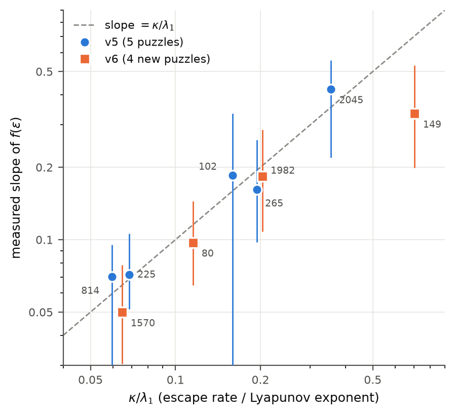
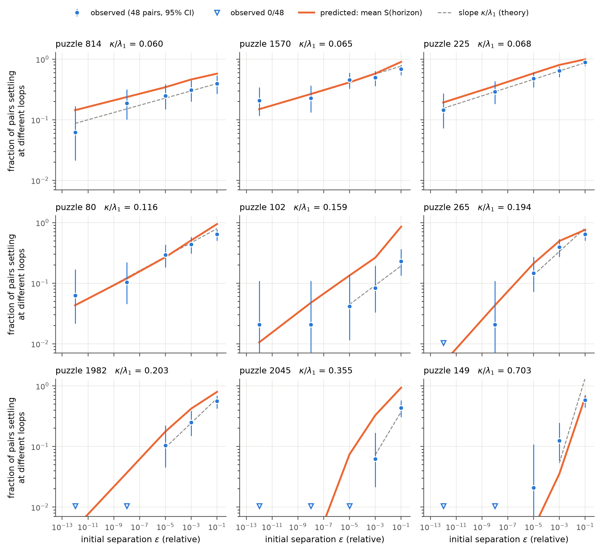
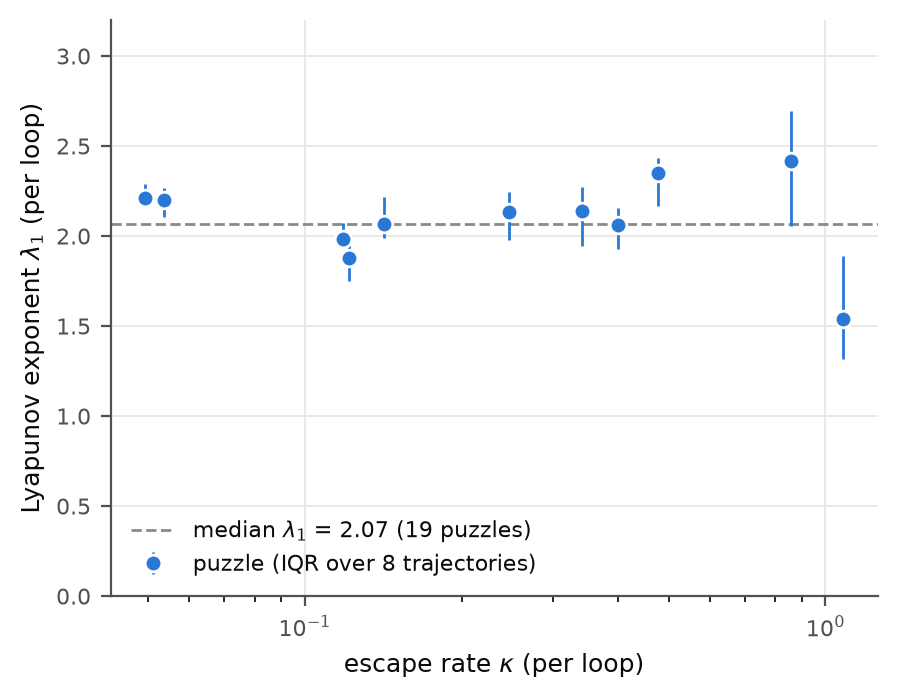
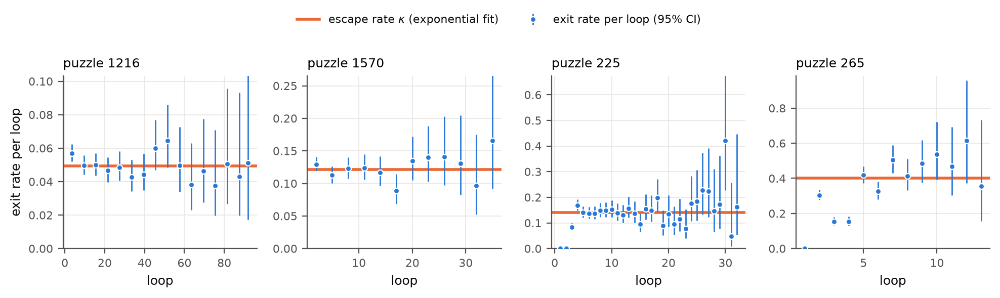

# Transient chaos in a latent-reasoning model: escape rate, Lyapunov exponent and the uncertainty exponent

Lai, Bao, Quinn & Gilpin ([*Fractal basins trap latent reasoning*](https://arxiv.org/abs/2609.04963), 2026) showed that
recurrent reasoning models have fractal **settle-time basins**: map the starting latent over a 2D slice, record how many
loops the model needs before its answer stops changing, and the map is fractal, more so for harder problems.

This repository measures the two dynamical rates behind those maps for the EqR Sudoku model, and tests the textbook
transient-chaos relation that connects them to the fractal structure:

$$f(\varepsilon) \;\propto\; \varepsilon^{\,\alpha}, \qquad \alpha = \kappa / \lambda_{\max}$$

Here $f(\varepsilon)$ is the fraction of starting points at distance $\varepsilon$ that settle at different loops,
$\kappa$ is the **escape rate** (how fast trajectories leave the transient), and $\lambda_{\max}$ is the **maximal
Lyapunov exponent** (how fast nearby trajectories separate) [Kantz & Grassberger 1985; Lai & Tél 2011, eq. 5.13;
Bódai & Lucarini 2020, eq. 24].

<picture>
  <source media="(prefers-color-scheme: dark)" srcset="figures/fig2_slope_vs_ratio_dark.png">
  
</picture>

## Results at a glance

| # | Result | Evidence | Status |
|---|---|---|---|
| 1 | The uncertainty exponent equals $\kappa/\lambda_1$ | 9 puzzles, true float64, $\varepsilon$ from $10^{-1}$ to $10^{-12}$: rank correlation 0.92; 8 of 9 slopes within −23% to +19% | Replicated on new puzzles (descriptive outcome in both pre-registrations) |
| 2 | $\lambda_1$ belongs to the model, $\kappa$ to the puzzle | $\lambda_1$ = 2.07 per loop (IQR 1.93–2.25) over 19 puzzles, uncorrelated with $\kappa$ (Spearman −0.01); $\kappa$ = 0.05–1.1 per loop, unrelated to the human difficulty rating (−0.14) | Measured |
| 3 | Ordinary transient chaos, not "doubly transient" | After a start-up of 2–6 loops the exit rate is constant: 11/11 late-window fits exponential; pooled rate change ×1.11 per 50 loops (95% upper bound ×1.36) | Measured, within loop caps of 120–150 |
| 4 | The boundaries are not "slim" | No steepening of $f(\varepsilon)$ over 11 decades: curvature +0.006 (95% CI −0.09 to +0.07); largest small-$\varepsilon$ slope 0.22 | Measured (7 puzzles) |
| 5 | A simple horizon law gets the amplitude within about 2× | $f \approx \langle S(\ln(0.1/d_0)/\lambda_1)\rangle$: 77% of 31 points within 2× (87% with each run's own survival curve); bias ≈ −20% | Partial: **failed** its registered bar in v5 (61% < 70%); held in v6 |
| 6 | `dtype=float64` in loopscape's EqR path runs in float32 | dtype-map fallback, plus upstream `rms_norm` casting to float32 | Reported: [GilpinLab/loopscape#1](https://github.com/GilpinLab/loopscape/issues/1) |
| ✗ | A constant "commitment delay" of ~2 loops | Fitted after v5, then tested on new puzzles in v6 | **Rejected** (refit 0.75 loops, outside the predicted 1.0–2.75; no delay fits better) |

Result 3 bears on an expectation in Lai et al. ("most reasoning models will exhibit some form of doubly transient
chaos"). Doubly transient chaos ([Motter et al. 2013](https://arxiv.org/abs/1310.4209)) has a settling rate that
grows over time, and boundaries that become smooth at small scales ([Chen, Nishikawa & Motter 2017](https://arxiv.org/abs/1705.02349)).
For EqR we see neither, within our windows. Other models in that paper may behave differently: in the FPRM maze model
we saw slow, nearly marginal drift rather than chaos.

## The main figure

<picture>
  <source media="(prefers-color-scheme: dark)" srcset="figures/fig1_eps_scaling_dark.png">
  
</picture>

Each panel shows one puzzle. **Blue:** the fraction of 48 pairs of starting latents, at relative distance
$\varepsilon$, whose settle times differ (95% Wilson intervals; triangles mark 0/48). **Grey dashed:** a line of slope
$\kappa/\lambda_1$, computed from separate measurements. **Orange:** the horizon prediction (result 5). Panels are
ordered by $\kappa/\lambda_1$: for the slow puzzles (top) disagreement persists down to $\varepsilon = 10^{-12}$, while
for the fast ones (bottom) it vanishes by $\varepsilon \approx 10^{-5}$–$10^{-8}$.

<table><tr>
<td><picture><source media="(prefers-color-scheme: dark)" srcset="figures/fig4_lambda_vs_kappa_dark.png"></picture></td>
<td><picture><source media="(prefers-color-scheme: dark)" srcset="figures/fig3_exit_rate_dark.png"></picture></td>
</tr></table>

**Left:** $\lambda_1$ against $\kappa$. The chaos rate is the same for every puzzle; only the escape rate changes.
**Right:** the exit rate (hazard) per loop against loop. It is constant after a short start-up, which is exponential
survival with rate $\kappa$.

## Why this matters

- **It explains why fractality tracks difficulty.** In a 2D slice the settle-time boundary has dimension
  $2 - \kappa/\lambda_1$. EqR's $\lambda_1$ is a fixed property of the trained model, so the fractality of a puzzle is
  set by a single number, its escape rate. Slower escape means a more space-filling boundary.
- **It sets a predictability limit.** For slow puzzles, $f(\varepsilon)$ stays above 5% even at $\varepsilon = 10^{-12}$.
  How long the model thinks is then **not a function of its starting state at float64 precision**, and float32
  settle-time maps are partly rounding-determined pixel by pixel, although their statistics are robust.
- **It is a quantitative bridge** between classical open-system chaos and a trained neural reasoner: a
  99,000-dimensional state (two $97 \times 512$ latents) whose transient obeys the same relation as a low-dimensional
  chaotic saddle.

## Setup

| | |
|---|---|
| Model | EqR Sudoku (`locuslab/EqR-model`, `sudoku-extreme/eqr.pth`, sha256 `258b1f0a…920d26`), via [GilpinLab/loopscape](https://github.com/GilpinLab/loopscape) commit `16b52aa` |
| Slice | loopscape's demo slice: a random orthonormal 2-plane (seed 0) in the $97\times512$ latent, $z_H = a\,u + b\,v$ with $a, b \in [-1, 1]$, $z_L = 0$, model noise off |
| Settle time | $T$ = the last loop at which the decoded grid changes (it never changes again afterwards) |
| Puzzles | Sudoku-Extreme test set; selection rules fixed in advance ([preregistration/](preregistration/)) |
| Escape rate $\kappa$ | Exponential fit to the survival $S(k) = P(T > k)$ of a 40×40 map (cap 150) over $0.9 \ge S \ge 0.02$; kept if $R^2 \ge 0.97$ |
| Lyapunov exponent $\lambda_1$ | Benettin twin trajectories with QR re-orthonormalisation ($K = 4$, relative offset $10^{-4}$), on the 8 slowest points of each map, 2-loop burn-in, each trajectory up to its own settle; median over points |
| $\varepsilon$-pairs | Base point uniform on the slice; partner $z_0 + \varepsilon \lVert z_0\rVert w$ with $w$ a random unit direction in the full latent; 48 pairs per $(\text{puzzle}, \varepsilon)$, both members in the same batch |
| Precision | $\varepsilon$-pairs in **true float64** (forward dtype float64 *and* `rms_norm` patched; checked in-kernel: separation after one loop scales 1000.0× between $\varepsilon = 10^{-3}$ and $10^{-6}$). Maps and $\lambda_1$ in float32: the twin offset $10^{-4}$ is about 1000× the float32 rounding level, so rounding changes $\lambda_1$ by roughly 0.1% |
| Compute | Kaggle T4 ×2; four runs, 11 h wall time in total (maps 4.4 h + 4.3 h, $\varepsilon$-pairs 1.4 h + 1.0 h) |

## Reproduce

```bash
pip install numpy scipy matplotlib
python analysis/key_numbers.py       # results 1, 2, 5 and the registered outcomes
python analysis/survival_shape.py    # result 3
python analysis/slim_check.py        # result 4
python analysis/figures.py           # figures/
```

Every number in this README is printed by one of these scripts from the raw outputs in [results/](results/). The GPU
experiments that produced those outputs are in [experiments/](experiments/). They install loopscape at the pinned
commit, verify the checkpoint hash, and audit its pickle before loading. [repro/](repro/) contains the 10-second CPU
reproduction of result 6.

## How this was done (and what failed)

Each confirmatory run was **pre-registered**: hypotheses, puzzle-selection rules and pass/fail bars were frozen before
any data, and amendments are dated in the files ([preregistration/](preregistration/)). Outcomes are reported as
registered:

- **v3b / v4:** the planned test of the lab's own roughness estimator against $\kappa/\lambda_1$ was **undetermined**.
  Only 3 of 19 puzzles gave a finite estimate, because the estimator saturates on slow puzzles. These runs supplied the
  $\kappa$ and $\lambda_1$ measurements used here.
- **v5:** the exponent matched on 5 new puzzles. The amplitude **failed** its registered accuracy bar (61% of points
  within 2×, bar 70%).
- **v6:** a post-hoc fix (a constant delay) was tested on 4 more puzzles. The registered bar passed, but the delay
  itself was **not** supported: the no-delay version did better. We report it as rejected.
- Two precision problems invalidated some early float64 comparisons. They were found, fixed and reported (result 6),
  and every float64 number here comes from runs with the in-kernel check.

The full history is in [docs/HISTORY.md](docs/HISTORY.md).

## Limitations

- One model (EqR) and one task (Sudoku): 9 puzzles for the exponent, 19 for $\lambda_1$, one 2D slice.
- Slopes come from 2–5 $\varepsilon$ levels with 48 pairs each. Puzzle 149 ($\kappa/\lambda_1 = 0.70$) has only 2
  usable levels and the largest deviation (ratio 0.48).
- $\alpha = \kappa/\lambda_{\max}$ does not distinguish rough from filamentary boundaries (Bódai & Lucarini 2020);
  that needs the cross-boundary Lyapunov exponent, which was not measured.
- Survival is exponential *within* loop caps of 120–150 with at least 20 trajectories still at risk; slower changes
  beyond that window cannot be excluded.

## References

- J. Lai, A. Bao, J. Quinn, W. Gilpin, *Fractal basins trap latent reasoning*, arXiv:2609.04963 (2026).
- H. Kantz, P. Grassberger, *Repellers, semi-attractors, and long-lived chaotic transients*, Physica D 17, 75 (1985).
- Y.-C. Lai, T. Tél, *Transient Chaos*, Springer (2011).
- T. Bódai, V. Lucarini, *Rough basin boundaries in high dimension: Can we classify them experimentally?*, arXiv:2001.08871 (2020).
- C. Grebogi, S. W. McDonald, E. Ott, J. A. Yorke, *Final state sensitivity: an obstruction to predictability*, Phys. Lett. A 99, 415 (1983).
- A. E. Motter, M. Gruiz, G. Károlyi, T. Tél, *Doubly transient chaos*, Phys. Rev. Lett. 111, 194101 (2013).
- Y. Chen, T. Nishikawa, A. E. Motter, *Slim fractals*, Phys. Rev. E 96, 032215 (2017).

## Citation and license

Code: MIT ([LICENSE](LICENSE)). If you use this, see [CITATION.cff](CITATION.cff).

**Acknowledgments:** Thanks to the authors of loopscape and EqR for releasing their code and checkpoints. Claude (Anthropic)
collaborated on this repository as an assistant. All decisions and claims, and the responsibility for them, rest
solely with the author.
