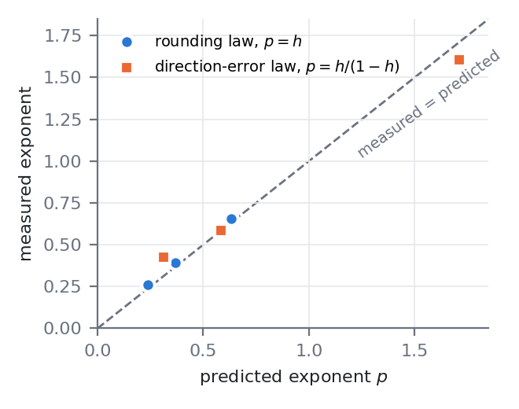

# Rough or filamentary? The cross-boundary exponent of EqR

**Second note:** [note/note.pdf](note/note.pdf), *Rough basin boundaries are computationally hidden: the cross-boundary
exponent of a latent-reasoning model* (2 pages).

The uncertainty exponent $\alpha = \kappa/\lambda_1$ (the main result of this repository) holds for both kinds of fractal
basin boundary distinguished by Bódai & Lucarini (2020):
- **filamentary:** a Cantor set of smooth sheets, cross-boundary exponent $\lambda_x = \lambda_1$;
- **rough:** a nowhere-differentiable surface, $\lambda_x < \lambda_1$.

Deciding between them requires $\lambda_x$. We tried to measure it for EqR and found why it cannot be measured in
practice, and what it would cost.

## Findings

| # | Finding | Evidence |
|---|---|---|
| 1 | EqR's chaotic set has 7–11 positive Lyapunov exponents (B&L's necessary condition for roughness holds) | 4 puzzles + 2 replicates, true float64, stagger-and-step trajectories |
| 2 | Escape is a small leak: 0.6–3% of the stretching ($\sum\lambda^+$ = 6.4–8.5 per loop, $\kappa$ = 0.05–0.25) | same |
| 3 | Escape is an abrupt "snap": one loop in which 27–30 of 81 cells change, then smooth convergence | every observed escape |
| 4 | The churn concentrates in the contested cells (partly self-contained; no token group is invariant) | exact Jacobian–vector products |
| 5 | Five classes of observable cannot tell rough from filamentary (degenerate or confounded) | toy families of known type |
| 6 | Only the exact cross direction separates them. Noise floors scale as $\varepsilon_{\rm mach}^{\,h}$ and $c^{\,h/(1-h)}$, with $h=\lambda_x/\lambda_1$ | toys, float16 to 40 digits (3/3 and 2/3 within 25%) |
| 7 | With any feedback, the direction must come from a genuine (kick-free) orbit; then the probe recovers $\lambda_x$ | toys: kicked orbits fail at feedback $10^{-3}$; 80-digit orbits 9/9 correct |
| 8 | Cost law: for EqR, a genuine orbit of 450–850 loops in 460–860-digit arithmetic. Decidable in principle, not in practice | from 6 + 7 and EqR's spectrum |
| 9 | Three tiny trained looped reasoners show no transient chaos (contracting, or neutral with $\lambda_1 \approx 0$) | capstone attempt |



## Layout

| folder | contents |
|---|---|
| [note/](note/) | the note (LaTeX + PDF); `make_figs.py` builds its figures from `toys/*.json` |
| [toys/](toys/) | every calibration on toys of known type: `s0*` (probes, spectra, CLVs, feedback, genuine orbits), `s4` (survival regression), `s5` (escape-triggered averages), `a1`/`a1b` (precision laws), `a3` (slice topology); each script's docstring holds its prediction, written before it ran, plus dated amendments |
| [eqr/](eqr/) | EqR measurements: `s2b_stagger.py` (stagger-and-step with backtracking), `s2c_benettin_along.py` (spectra), `s2_analyze.py` (pre-registered analysis), `s3a_jvp.py` (exact forward-mode JVPs through EqR), `s3c`/`s3d` (CLV probe, stopped at its feasibility gate), `a4_coupling.py` (token-group coupling); `data/` holds the spectra and the trajectories' decoded grids and kicks |
| [capstone/](capstone/) | the three tiny-reasoner attempts and their report |
| [reports/](reports/) | pre-registrations, every report, the chronological [STATUS](reports/STATUS_cross_boundary.md) and the consolidated [FINDINGS](reports/FINDINGS_cross_boundary_2026-10-28.md) |

## Reproduce

```bash
pip install numpy scipy matplotlib mpmath
cd cross_boundary/toys && python a1_precision_law.py      # precision law (~20 s); likewise any other toy script
cd ../note && python make_figs.py                          # figures from the toy outputs
cd ../eqr && python s2_analyze.py data/s2c_r206.npz data/s2c_r814.npz data/s2c_r225.npz data/s2c_r80.npz   # registered verdict
```

The EqR scripts need loopscape at commit `16b52aa` (CPU is enough; ~0.5 s per sample-loop in float64), and they run
in true float64 with both precision fixes. Not included: the stored latent states of the stagger trajectories
(~280 MB; regenerate with `s2b_stagger.py ROW NLOOPS OUT.npz`) and a prepared but never-run GPU kernel.
Tiny-model checkpoints are not included either; `capstone/g1*.py` retrains them in minutes.

## Honesty notes
- Several toy tests failed before an amendment, and five whole approaches failed. Each failure is reported, with its
  cause, in [reports/](reports/).
- The degeneracy (finding 5) is an argument with numerical support, not a theorem. The laws are verified on toys of
  2–30 dimensions. The EqR price assumes a skew-rough boundary ($h = \kappa/\lambda_1$).
